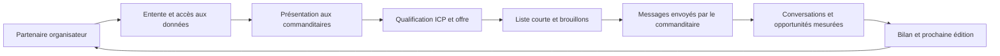

# Les deux motions GTM

**Consolidation au 13 octobre 2026.** Architecture de [S27](../sources/text/S27.md), [S28](../sources/text/S28.md) et [S33](../sources/text/S33.md), corrigée sur le périmètre selon [S05](../sources/text/S05.md).

## Motion 1 — bâtir le catalogue

Identifier un événement et son programme de commandite, qualifier la composition des acheteurs, obtenir l’accès à un décideur organisateur, formaliser la distribution et le partage des données, puis prévoir l’introduction aux exposants. Un logo, une discussion ou un ancien pilote ne signifie pas partenariat actuel signé.

Les sources proposent deux fenêtres : 6–16 semaines avant l’événement pour l’activation, et environ deux semaines après pour le bilan et les forfaits de l’édition suivante. Elles sont complémentaires si l’on distingue **activation de l’édition actuelle** et **construction du partenariat suivant**. Le vrai calendrier dépend de celui de l’organisateur.

## Motion 2 — vendre la préparation

L’introduction organisateur est le chemin prioritaire documenté. Le contact direct ciblé peut compléter le canal lorsque l’inscription, le décideur et la livraison sont connus. Les documents de mai envisagent de réduire cette voie ; ce choix n’est pas suffisamment établi pour la supprimer du modèle consolidé.

Qualification → brief ICP → offre précise → contrat et dépôt → production → liste courte → envoi par le commanditaire → mesure. Les délais historiques de vente doivent servir à formuler une hypothèse et un besoin de suivi, pas à promettre une signature sous deux jours.

## Offre secondaire — Walk the Floor

CDWare constitue le précédent standalone. La vente n’a pas la même urgence ni le même cycle. Elle doit avoir son propre périmètre et ses propres KPI ; ne pas la compter comme une édition d’événement ni comme preuve de productivité de la motion sponsor.

## Contrainte de capacité

Le dossier HOP d’août propose six commanditaires pour deux personnes et une livraison manuelle ; ALL IN quatre. Aucun relevé de temps ni engagement de ressources ne confirme ces plafonds aujourd’hui. Mesurer le temps par brief, profil et brouillon, puis la capacité restante par événement, avant d’accepter du volume.

La réussite recherchée n’est pas le seul nombre de matchs : le commanditaire doit utiliser le livrable. Suivre l’envoi, les conversations et les opportunités avec des définitions stables dans le [pipeline](../operations/pipeline-et-mesure.md).
